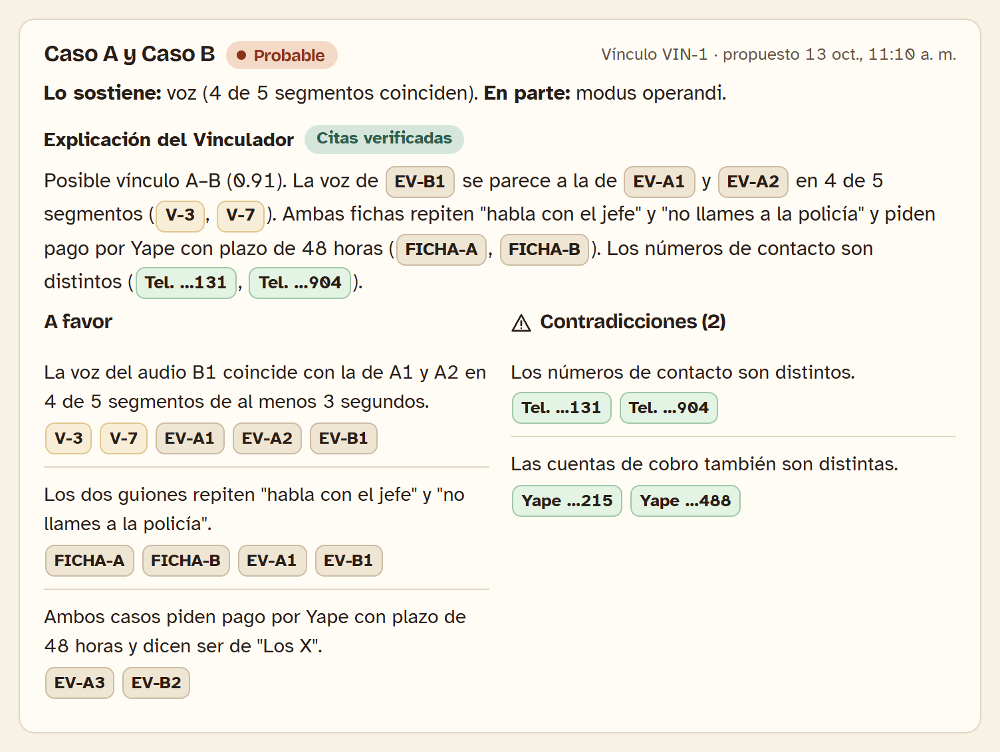
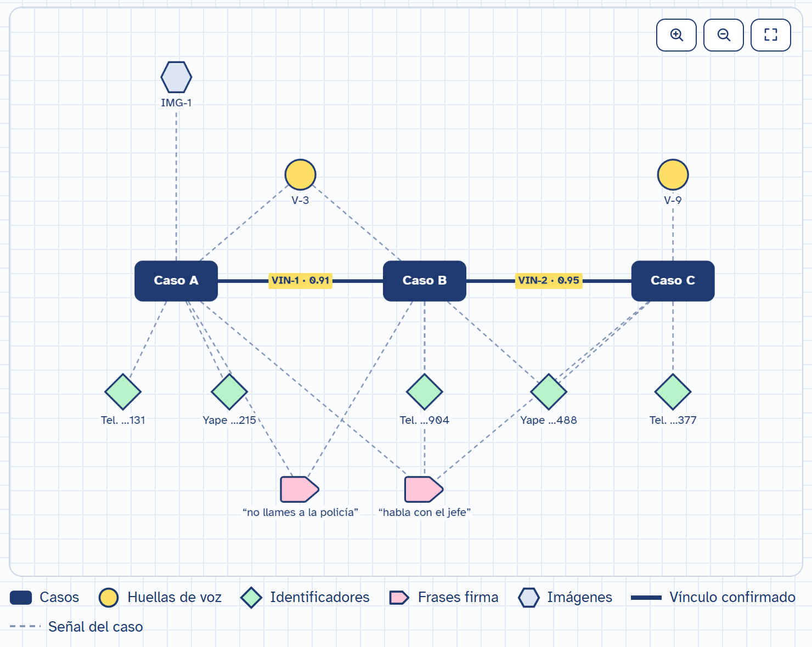
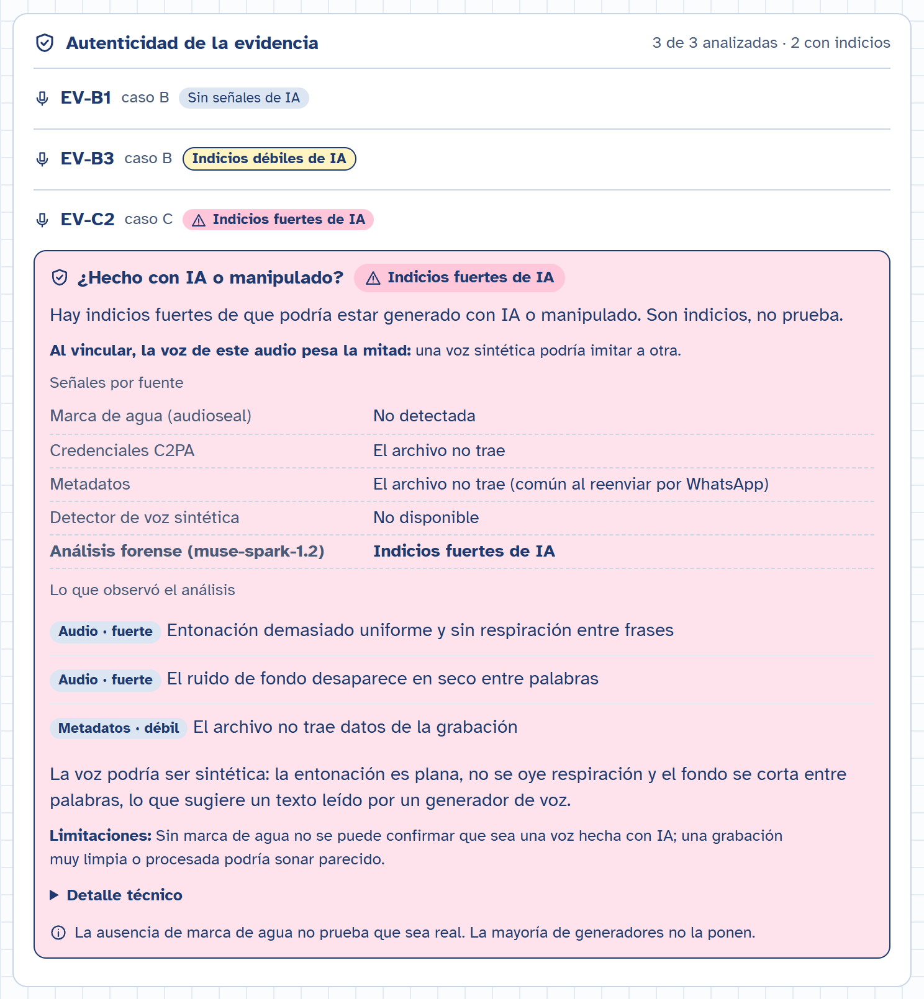
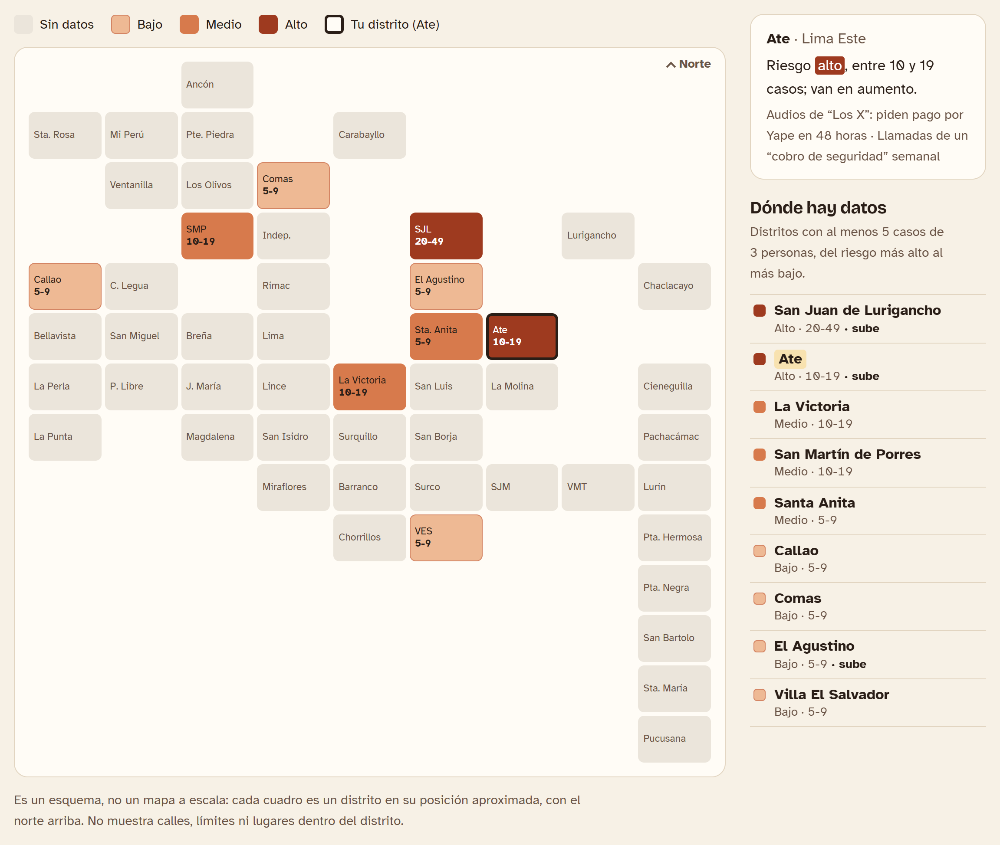
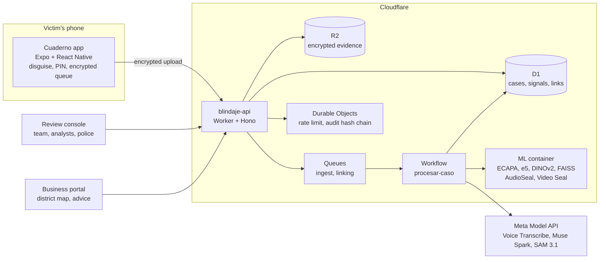

# Blindaje

**Community intelligence against extortion in Peru.** Victims keep the evidence they already receive
(WhatsApp voice notes, photos, messages, calls) inside an app disguised as an ordinary business
notebook. Blindaje transcribes it, turns it into comparable signals and finds the cases that come from
the same network: the same voice calling from different numbers, the same account collecting from
different vendors, the same photos and the same script. A person reviews every link. The public only
sees which districts it happens in, never which home.

Built for the **Meta Global AI Developer Hackathon 2026** (Indie track), between October 28 and
November 4, 2026. Every case, voice, number, account and photo in this repository and in the demo is
**fictitious**.

| | |
|---|---|
| Landing (ES / EN) | https://blindaje-landing.vigiaperu.workers.dev |
| Business portal (district map) | https://blindaje-negocios.vigiaperu.workers.dev |
| Review console (read-only login below) | https://blindaje-console.vigiaperu.workers.dev |
| API health | https://blindaje-api.vigiaperu.workers.dev/v1/health |
| Android app (demo build) | [GitHub releases](https://github.com/EdwinSotto123/blindaje/releases) |

**Try the console.** Log in as `jurado@demo.blindaje.test` with password `Jurado-Demo-2026`. It is a
read-only account: it sees everything the Blindaje admin sees (link queue with the evidence behind each
signal, networks, district view, alerts, monitoring, audit chain, vector engine), but the API rejects
any approval, edit or agent run. All data is fictitious.

> **En español.** Blindaje es inteligencia comunitaria contra la extorsión. La víctima guarda la
> evidencia en una app disfrazada de cuaderno de ventas; el sistema la transcribe con Muse Voice
> Transcribe, arma la ficha del caso con Muse Spark y vincula los casos de una misma red por la voz,
> las cuentas, las fotos y el guion. Una persona del equipo revisa cada vínculo; la policía recibe
> expedientes; el público y los negocios ven un mapa por distrito, en rangos y nunca con direcciones.
> Toda la documentación de detalle está en español: [`DEVLOG.md`](DEVLOG.md),
> [`SECURITY.md`](SECURITY.md), [`PRIVACY.md`](PRIVACY.md), [`PLAN.md`](PLAN.md) y el
> [documento de diseño](docs/blindaje-inteligencia-comunitaria.md).

## The problem

- **13,892** extortion reports were filed with Peru's Public Ministry between January and July 2026
  ([Exitosa](https://www.exitosanoticias.pe/actualidad/extorsion-peru-registran-mas-13-mil-denuncias-durante-primeros-siete-meses-2026-n182874)).
- **80%** of public transport companies admitted paying monthly protection fees; at least 69 drivers
  were killed on the job in 2025
  ([La República](https://larepublica.pe/opinion/2026/06/22/la-inseguridad-ciudadana-que-requiere-atencion-editorial-777876)).
- Reports went from 4,761 to 26,217 while sentenced prisoners fell from 712 to 650
  ([El Comercio](https://elcomercio.pe/peru/extorsion-denuncias-pasan-de-4761-a-26217-pero-presos-sentenciados-bajan-de-712-a-650-apuesplan-noticia/)).

Gangs work in series, but the evidence is scattered across the phones of people who never meet:
untranscribed voice notes, undated screenshots, timelines rebuilt from memory. Nobody compares the voice
threatening a shopkeeper with the one threatening a mototaxi driver in another district, and many
victims never report for fear of retaliation.

## What it does

| Who | What they get |
|---|---|
| **Victim** | An Android app that looks like a sales notebook, shopping list or change calculator (their choice) and really works. A secret entry plus PIN opens private notes; a decoy PIN opens believable empty ones. Record, photograph, share from WhatsApp or paste a message: it uploads encrypted and stays out of the gallery. Zero notifications, quick exit, emergency wipe. Optional call log for unknown numbers that the person classifies as extortion, with an in-call bubble. |
| **Blindaje team** | A review console: every proposed link between cases with its score and the evidence behind each signal, network graphs, authenticity checks (is this voice AI-made?), agent drafts to approve, and a monitoring panel. |
| **Police and prosecutors** | PDF case files of an approved network, with a timeline and chain of custody. |
| **Public and businesses** | A district map of Lima and Callao (ranges, no totals, at least 5 cases from 3 different victims) and prevention advice by area and trade, approved by a person. No account needed. |

<table>
  <tr>
    <td></td>
    <td></td>
  </tr>
  <tr>
    <td>Same voice, different number: the link is proposed with its evidence and waits for a reviewer.</td>
    <td>The network built from approved links.</td>
  </tr>
  <tr>
    <td></td>
    <td></td>
  </tr>
  <tr>
    <td>Authenticity: AudioSeal, Video Seal, C2PA and Muse Spark look for signs of AI.</td>
    <td>The public map: districts and ranges, never addresses.</td>
  </tr>
</table>

More in [`docs/screenshots/`](docs/screenshots/).

## Built with Meta AI

Each model has a specific job. The agents run on Muse Spark through the Responses API with strict JSON
schema output; the investigative ones use tool calling. Every claim must cite evidence or the output is
rejected, web search is off and no agent ever names a person.

| Model | Where | What it does in Blindaje |
|---|---|---|
| **Muse Voice Transcribe 1.0** (`muse-voice-transcribe-1.0`) | Meta Model API | Transcribes voice notes and calls with speaker diarization, per-turn timestamps and a custom vocabulary (Yape, Plin, *cupo*, *derecho de piso*). The turns feed per-speaker voiceprints. |
| **Muse Spark 1.3** (`muse-spark-1.3`) | Meta Model API | Builds the case record (amount, deadline, payment channel, identifiers, signature phrases) with strict schema output, and drives six agents: Linker, Cartographer, Lookout, Case writer, Advisor and Authenticity. Looks for manipulation in photos and videos. |
| **Muse Spark 1.2** (`muse-spark-1.2`) | Meta Model API | Listens to the audio itself for the forensic voice check (breathing, intonation, artifacts), since 1.3 lacks full audio input. |
| **SAM 3.1** (`sam-3.1`) | Meta Model API | Finds bullets, handwritten notes and license plates in photos and video frames from text prompts, and masks bystanders' faces. |
| **Muse Image 1.0** (`muse-image-1.0`) | Meta Model API | Generated the fictitious photos used in the demo and the evaluation. |
| **Muse Wonder 1.0** (`muse-wonder-1.0`) | Meta Model API | Optional: the Cartographer uses it for very large networks. |
| **AudioSeal** | Open weights, ML container | Detects AI watermarks in audio. Used in reverse too: every audio copy the console plays carries a 16-bit tag of the account that opened it, so a leaked copy can be traced. |
| **Video Seal** | Open weights, ML container | Detects AI watermarks in images and video, and marks every image delivery with a 256-bit message for leak tracing. |
| **DINOv2** (small) | Open weights, ML container | Vectors for image crops, to find reused photos even when they are not identical. |
| **Llama Prompt Guard 2** | Open weights, ML container | Screens every evidence text before it reaches the agents, since extortion messages are untrusted input. Integrated and tested; the gated weights are pending Hugging Face access, so today the defense is that evidence goes in delimited as data and the prompts forbid following instructions inside it. |
| **FAISS** | Library, ML container | Voice, text and image search indexes. |
| **PyTorch, React Native, React** | Libraries | The ML container, the victim's app and the web apps. |

What is not Meta, said plainly: voiceprints use SpeechBrain ECAPA and text vectors use
multilingual-e5-small, because the Meta Model API has no embeddings endpoint. We evaluated Muse Glimmer
for building the case record offline on the phone; at about 17 GB even at 4 bits it does not fit, so the
record is built on the server, with consent.

## How it works



1. **Capture.** The app stores each piece encrypted on the phone and uploads it to the API, which
   re-encrypts it in R2 (AES-256-GCM) and writes it to a hash-chained audit log.
2. **Process.** A Workflow transcribes it, builds the case record, segments images, computes
   voiceprints and vectors, and checks authenticity.
3. **Link.** The linking engine compares voice, identifiers (phones, accounts and plates compared as
   HMAC-SHA256; the console shows only the last 3 digits), images, script phrases, area and time, with
   calibrated probabilities. The Linker agent
   explains each candidate. Voice alone never reaches "probable": a person always decides.
4. **Act.** Approved links grow networks. The Cartographer profiles them, the Lookout drafts district
   alerts (5 cases, 3 victims, 14 days), the Advisor drafts prevention advice and the Case writer
   produces the PDF for the police. Each draft waits for a person.

## Evaluation

Real results of `pnpm eval` on fictitious data and open Peruvian Spanish voices (OpenSLR SLR73,
CC BY-SA 4.0). Full report: [`eval/REPORT.md`](eval/REPORT.md).

| Metric | Result | Target |
|---|---|---|
| Voice linking: correct case ranked first | 100.0% | ≥ 80% |
| Voice linking: correct case in the top 3 | 100.0% | ≥ 90% |
| False links per 100 comparisons above the review threshold | 0.19 | ≤ 2 |
| Exact identifier matches detected | 100% (9/9, 0 false) | 100% |
| Case record fields correct vs. manual labels (Muse Spark 1.3) | 98.3% | ≥ 90% |
| Infiltrator test: a victim account gets no links or other cases' data | passes (8/8) | passes |
| Agent claims with verifiable cited evidence (Linker and Lookout) | 100% (49/49) | 100% |
| Statistics shown with fewer than 5 cases | pending: no networks yet (they form when a person approves links) | 0 |

Voices were simulated through two phones and WhatsApp-like Opus compression; SLR73 is read speech, so
real voice notes will spread the distributions. That is why voice alone never links two cases.

Leak tracing ([`eval/results/watermark.json`](eval/results/watermark.json)): audio forwarded through
WhatsApp (Opus 16 kbps) and images recompressed, cropped or screenshotted were attributed to the right
account 100% of the time, with 0% false positives. An audio clip cut at an arbitrary point usually loses
the message.

## Safety by design

What Blindaje does not do, enforced in code and tests:

- It decides nothing without a person: every link, alert, advice and case file is a draft until an
  authorized person approves it.
- It does not identify people: it links cases and signals, never puts a name to a voice and never
  searches anyone online.
- It never shows a victim other victims' data, nor tells them their case was linked.
- It never advises paying or negotiating; it points to 105, Línea 1818 and the police.
- It publishes no addresses or exact counts: districts, ranges, at least 5 cases from 3 victims.
- It uses no real data in the demo.

The server processes evidence to transcribe and compare it, so this is not end-to-end encryption:
evidence is encrypted in transit and at rest, access is role-based and there is a hash-chained audit
log with a verification endpoint. Details
and the threat model are in [`SECURITY.md`](SECURITY.md) and [`PRIVACY.md`](PRIVACY.md). A legal review
under Peru's Law 29733 is required before any pilot with real victims.

## Repository

```
apps/mobile          Victim app (Expo SDK 58, React Native), disguised as "Cuaderno"
apps/console         Review console (React + Vite)
apps/portal          Business portal with the district map (React + Vite)
apps/landing         Landing page (Astro), Spanish and English
services/api         Cloudflare Worker: Hono, D1, R2, Queues, Workflows, Durable Objects, Containers
services/ml          ML container (Python): voiceprints, text and image vectors, FAISS, watermarks
packages/shared      Zod contracts, identifier normalization and HMAC, agent prompts
packages/meta-client Meta Model API client
eval                 Evaluation, fictitious scripts, demo seed
infra/migrations     D1 migrations
```

## Run it locally

Requirements: Node 22 (Astro needs 22.23.4 or later), pnpm 9. Optional: Python 3.11 with `uv` for the ML
container, JDK 21 and the Android SDK for the app.

```bash
pnpm install

# API (http://localhost:8787)
cp services/api/.dev.vars.example services/api/.dev.vars   # fill in the values
pnpm --filter @blindaje/api db:migrate:local
pnpm --filter @blindaje/api dev

# Console and business portal without a backend (fictitious mock data)
pnpm --filter @blindaje/console exec vite --mode mock
pnpm --filter @blindaje/portal exec vite --mode mock

# Landing
pnpm --filter @blindaje/landing dev

# Checks
pnpm typecheck && pnpm lint && pnpm test
```

ML container (see [`services/ml/README.md`](services/ml/README.md)):

```bash
docker build --platform linux/amd64 -t blindaje-ml services/ml
docker run --rm -p 8080:8080 blindaje-ml     # then ML_URL=http://localhost:8080 in .dev.vars
```

Android app (a native build is required: SQLCipher and a local native module; it does not run in Expo
Go). It is an independent npm project; see [`apps/mobile/README.md`](apps/mobile/README.md):

```bash
cd apps/mobile
npm install
npm run start:mock        # app against a fictitious in-memory API
npx expo run:android      # development build on a device
```

Evaluation and demo data:

```bash
pnpm eval                          # voice, images, case record, identifiers, scenarios, API
pnpm demo:reset && pnpm demo:seed  # fictitious cases A to G against the API (API_URL, DEMO_SECRET)
```

## Deploy

```bash
cd services/api
npx wrangler d1 migrations apply blindaje --remote
npx wrangler secret put MODEL_API_KEY   # also HMAC_ALLIANCE_KEY, EVIDENCE_ENCRYPTION_KEY, JWT_SECRET,
                                        # DEMO_SECRET, DEMO_ADMIN_PASSWORD, TURNSTILE_SECRET and
                                        # optionally CHROMA_API_KEY, CHROMA_TENANT
npx wrangler deploy --containers-rollout=none

pnpm --filter @blindaje/console deploy
pnpm --filter @blindaje/portal deploy
```

The ML container image is defined in `services/ml/Dockerfile` and bound as a Cloudflare Container
(`standard-2`, up to 3 instances); it needs the Workers Paid plan.

## Built during the hackathon

The repository starts on October 28, 2026; every commit is from the event. Day by day, with details in
[`DEVLOG.md`](DEVLOG.md):

- **Oct 28.** Monorepo, shared contracts and D1 schema. API with authentication, encrypted evidence,
  audit chain, costs and rate limiting. Processing Workflow with Voice Transcribe, Muse Spark and SAM
  3.1; ML container with voiceprints, vectors and FAISS. Linking engine and agents. The disguised app.
  Evaluation with OpenSLR voices and calibration. Watermark-based authenticity and leak tracing.
  Business portal. Landing. First APK. At night, a product redesign: anyone can report directly, a
  central team reviews, and the public sees a district map.
- **Oct 29.** District map first. Warmer visual direction for the landing, portal and console. Vector
  engine on Chroma Cloud with an animated view for the admin. Speed work and a monitoring panel. Call
  log for unknown numbers and a home-screen widget in the app.
- **Oct 30.** First build of the app's native module and the in-call bubble.

## Limitations

- **The ML container is switched off in the deployed API** (`ML_CONTAINER=off`). The seeded demo
  cases were processed with it and keep their voiceprints, vectors and links; a new upload today is
  stored, transcribed and summarized, but gets no voice or image vectors until the container is back.
- Voice calibration comes from read speech with simulated WhatsApp compression; it must be recalibrated
  with real voice notes. The statistics metric waits until reviewers approve links and networks form.
- Android does not let any third-party app record call audio. The app logs calls from unknown numbers
  and guides the person to the phone's own recorder; the recording is attached afterwards.
- The Android build is signed with a debug key and is meant for the demo. There is no iOS build.
- The accounts that can approve, edit or run agents have their passwords only as secrets; the public
  judge account is read-only, so it cannot show approving a link live (the video does).

## License

[Apache-2.0](LICENSE)
