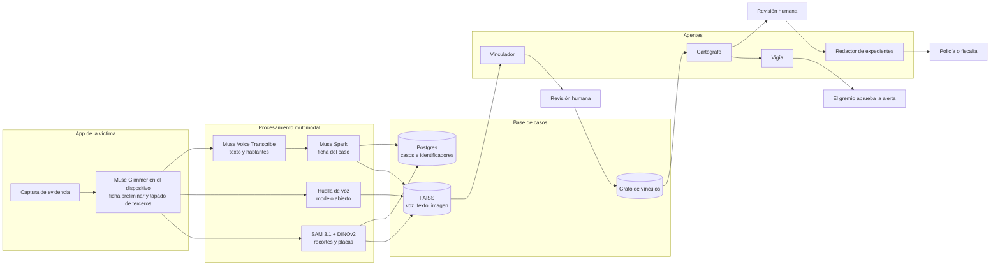
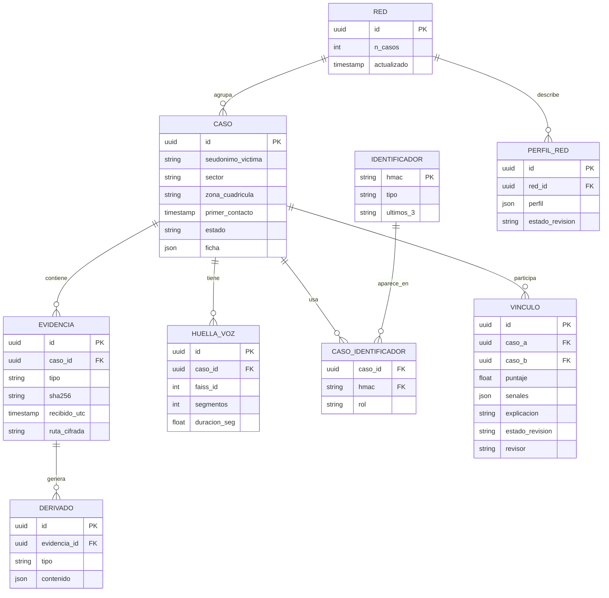

# Blindaje: inteligencia comunitaria contra la extorsión

**Proyecto para el Meta Global AI Developer Hackathon (track Indie, tema "Build for Your World")**
Documento de diseño · versión 1.0 · 27 de octubre de 2026

> Cada víctima de extorsión tiene una pieza del rompecabezas: un audio, un número, una cuenta de Yape, una foto. Sola, esa pieza casi no sirve. Unidas con consentimiento, de forma segura y con revisión humana, revelan la red que está detrás. Blindaje convierte la evidencia dispersa de muchas víctimas en expedientes de red que la policía y la fiscalía pueden usar, y en alertas preventivas que protegen a la comunidad.

---

## Índice

1. [Resumen ejecutivo](#1-resumen-ejecutivo)
2. [El problema](#2-el-problema)
3. [La idea: inteligencia comunitaria](#3-la-idea-inteligencia-comunitaria)
4. [Propuesta de valor por actor](#4-propuesta-de-valor-por-actor)
5. [Lo que Blindaje no hace](#5-lo-que-blindaje-no-hace)
6. [Arquitectura general](#6-arquitectura-general)
7. [Pipeline de ingesta de evidencia](#7-pipeline-de-ingesta-de-evidencia)
8. [Modelo de datos](#8-modelo-de-datos)
9. [Motor de vinculación de casos](#9-motor-de-vinculación-de-casos)
10. [Los agentes](#10-los-agentes)
11. [Inteligencia comunitaria y colaboración](#11-inteligencia-comunitaria-y-colaboración)
12. [Seguridad, privacidad y ética](#12-seguridad-privacidad-y-ética)
13. [Tecnologías de Meta y su rol](#13-tecnologías-de-meta-y-su-rol)
14. [Costos y modelo de negocio](#14-costos-y-modelo-de-negocio)
15. [Cómo responde a los criterios de los jueces](#15-cómo-responde-a-los-criterios-de-los-jueces)
16. [Evaluación](#16-evaluación)
17. [Plan de trabajo hasta el 4 de noviembre](#17-plan-de-trabajo-hasta-el-4-de-noviembre)
18. [Guion del video demo de 3 minutos](#18-guion-del-video-demo-de-3-minutos)
19. [Hoja de ruta después del hackathon](#19-hoja-de-ruta-después-del-hackathon)
20. [Referencias](#20-referencias)

---

## 1. Resumen ejecutivo

**Qué es.** Una plataforma con tres capas:

| Capa | Para quién | Qué recibe |
|---|---|---|
| Víctima | Bodegueros, mototaxistas, transportistas, comerciantes | Un lugar seguro para documentar amenazas y armar una denuncia sólida |
| Comunidad | Gremios, asociaciones de mercado, juntas vecinales | Alertas anónimas sobre modalidades nuevas en su zona |
| Autoridad | Policía, fiscalía, aliados con convenio | Expedientes de red: casos vinculados, cronología, evidencia y cadena de custodia |

**Cómo funciona en una frase.** Cada pieza de evidencia (audio, mensaje, imagen, video) se convierte en señales comparables: huella de voz, ficha del modus operandi, identificadores cifrados y recortes de imagen. Un motor de vinculación encuentra casos relacionados y agentes de IA construidos con Muse Spark analizan las redes resultantes, siempre con revisión humana antes de cualquier conclusión.

**Por qué ahora.** La extorsión es hoy una de las principales preocupaciones de seguridad en el Perú, muchas víctimas no denuncian por miedo y entre la denuncia y la condena hay una brecha enorme. El cuello de botella no es solo la cantidad de denuncias, sino la calidad de la evidencia y la capacidad de conectar casos.

**Tecnologías de Meta.** Muse Voice Transcribe, Muse Spark (1.3 y 1.2), SAM 3.1 en imagen y video, Muse Glimmer en el dispositivo de la víctima, y las librerías abiertas de Meta FAISS y DINOv2. Opcionalmente Muse Wonder para análisis de redes grandes y Muse Spark Open para afinar el extractor de fichas.

**Costo por caso estimado.** Entre 0.20 y 0.35 dólares de API (detalle en la sección 14).

---

## 2. El problema

### 2.1 Las cifras

- Entre enero y julio de 2026 el Ministerio Público registró **13,892 denuncias por extorsión** a nivel nacional. Los distritos fiscales con más casos fueron Lima Este (1,806), La Libertad (1,625), Lima Sur (1,346), Lima Norte (1,305) y Lima Centro (1,178).
- El año 2025 cerró con más de **27,000 denuncias por extorsión** y 2,451 homicidios según datos de la Fiscalía citados por La República.
- Según el mismo editorial, el **80% de las empresas de transporte público admitió pagar cupos mensuales** a bandas criminales, y al menos 69 conductores fueron asesinados durante su jornada en 2025, con la extorsión como principal móvil.
- Especialistas advierten que las cifras oficiales **subestiman el problema**, porque muchas víctimas no denuncian por temor a represalias.
- En el periodo analizado por El Comercio, las denuncias por extorsión pasaron de 4,761 a 26,217 mientras los presos sentenciados bajaron de 712 a 650. El propio medio aclara que las cifras por sí solas no explican la diferencia, pero muestran que más denuncias no se traducen automáticamente en más condenas.

Las fuentes completas están en la sección 20.

### 2.2 El hueco que nadie está llenando

Hoy cada denuncia se procesa casi como un caso aislado. Pero las bandas operan en serie: la misma voz llama a varias víctimas, la misma cuenta recibe pagos de distintos comerciantes, el mismo guion se repite en un mercado y luego en otro. Esa información existe, pero está dispersa en los celulares de cientos de víctimas que no se conocen entre sí.

Los tres problemas concretos:

1. **Evidencia débil.** Audios de WhatsApp sin transcribir, capturas sin fecha, cronologías reconstruidas de memoria.
2. **Casos desconectados.** Nadie compara sistemáticamente la voz del audio de una bodeguera con la del audio de un mototaxista en otro distrito.
3. **Miedo a denunciar.** La víctima no sabe si denunciar sirve, teme que el extorsionador se entere y no tiene a quién recurrir con confianza.

---

## 3. La idea: inteligencia comunitaria

La inteligencia comunitaria parte de una idea simple: **una comunidad organizada sabe más que cualquiera de sus miembros por separado**, siempre que pueda compartir información sin exponerse.

Blindaje hace posible ese compartir de forma segura:

- Cada víctima aporta sus piezas de evidencia con **consentimiento explícito**.
- Las piezas se convierten en señales que se pueden comparar **sin exponer los datos crudos**: huellas de voz cifradas, identificadores con HMAC, fichas sin datos personales de la víctima.
- Cuando varias piezas coinciden, el sistema propone un vínculo; **una persona lo revisa** antes de que exista.
- Los vínculos confirmados forman **redes**, que un agente analiza para entender cómo opera cada banda.
- El valor regresa a la comunidad en forma de **alertas preventivas anónimas** y a las autoridades en forma de **expedientes de red**.

### El ejemplo que guía todo el documento

| Momento | Qué pasa | Qué detecta Blindaje |
|---|---|---|
| Semana 1 | La **Persona A**, bodeguera, recibe dos audios de voz masculina, un mensaje que exige 2,000 soles por Yape en 48 horas y una foto de su tienda con una bala encima | Se crea el caso A con su ficha, huella de voz, identificadores e imágenes |
| Semana 2 | La **Persona B**, mototaxista en otro distrito, recibe un audio desde otro número | La huella de voz coincide con A y el guion se repite ("habla con el jefe", "no llames a la policía"); se propone el vínculo A–B |
| Semana 3 | La **Persona C**, comerciante de mercado, recibe la instrucción de pagar a la misma cuenta de Yape que le dieron a B | El identificador cifrado coincide; C se vincula a B y aparece una red de tres casos |
| Semana 4 | El agente analiza la red | Perfil de red: una voz que llama, una cuenta recaudadora, un guion común, escalamiento físico a los pocos días del plazo vencido |
| Semana 4 | La autoridad recibe el expediente y la comunidad recibe una alerta | "Circulan audios que dicen ser de 'Los X' y piden pago por Yape. No negocies solo: denuncia en la Línea 1818 o en tu comisaría" |

---

## 4. Propuesta de valor por actor

| Actor | Su dolor hoy | Lo que gana con Blindaje |
|---|---|---|
| Víctima | Está sola, con miedo, y su evidencia está desordenada | Documenta en minutos, recibe un borrador de denuncia sólido y sabe que su caso suma a algo más grande |
| Gremio o asociación | Sus miembros pagan cupos y no tiene datos para actuar ni negociar con autoridades | Un canal confiable para sus miembros, alertas de modalidades y reportes agregados para exigir atención |
| Policía y fiscalía | Reciben miles de denuncias aisladas con evidencia de calidad variable | Expedientes ordenados, casos ya vinculados, cronologías y cadena de custodia |
| Fintech o banco (con convenio y por canales legales) | Sus cuentas se usan para cobrar extorsiones | Información sobre cuentas vinculadas a varios casos, canalizada a través de requerimientos formales |
| Municipalidad | Presión ciudadana y poca información accionable | Mapa agregado de modalidades por zona para coordinar serenazgo y prevención |

---

## 5. Lo que Blindaje no hace

Estos límites son parte del diseño, no una nota al pie. Protegen a las víctimas, evitan errores graves y mantienen el proyecto dentro de las reglas del hackathon.

- **No identifica personas por nombre.** Vincula casos y señales; nunca le pone nombre a una voz ni busca a alguien en redes sociales.
- **No hace OSINT sobre individuos.** La búsqueda web está desactivada para los agentes de análisis.
- **No muestra a una víctima información de otras víctimas** ni le avisa que su caso fue vinculado.
- **No decide culpabilidad.** Todo vínculo es una hipótesis con nivel de confianza y evidencia citada, y pasa por revisión humana.
- **No reemplaza a la policía ni a la fiscalía.** Siempre deriva a los canales oficiales.
- **No aconseja pagar ni negociar con extorsionadores.**
- **No publica mapas ni datos abiertos.** Las vistas comunitarias son agregadas y requieren un mínimo de casos.
- **No tiene contenido político.** Ni candidatos, ni partidos, ni evaluación de gobiernos; las reglas del hackathon excluyen proyectos políticos.

---

## 6. Arquitectura general



### Componentes

| Componente | Tecnología sugerida | Responsabilidad |
|---|---|---|
| App de la víctima | Web móvil (PWA) o Android; Muse Glimmer con ExecuTorch para el procesamiento local | Captura, cifrado local, ficha preliminar, consentimiento |
| API de ingesta | FastAPI | Recibe evidencia, calcula huellas de integridad, encola procesamiento |
| Procesamiento | Workers en Python; ffmpeg; llamadas a la Meta Model API | Transcripción, huellas de voz, fichas, segmentación |
| Base relacional | Postgres | Casos, evidencias, identificadores cifrados, vínculos, auditoría |
| Base vectorial | FAISS (librería abierta de Meta), tres índices | Búsqueda de vecinos por voz, texto e imagen |
| Grafo | networkx en el prototipo; tablas de aristas en Postgres | Redes de casos, detección de comunidades, centralidad |
| Agentes | Muse Spark 1.3 con tool calling vía Responses API | Vinculación, análisis de redes, alertas, expedientes |
| Consola de revisión | Web interna con roles | Revisores del gremio y analistas autorizados confirman o descartan |

---

## 7. Pipeline de ingesta de evidencia

Todo el pipeline se ilustra con el caso A.

### 7.1 Registro y cadena de custodia

1. Cada archivo original recibe una huella **SHA-256**, una marca de tiempo UTC y el identificador seudónimo de quien lo subió.
2. El registro de auditoría es de solo escritura y encadenado: cada entrada incluye el hash de la anterior, de modo que cualquier alteración se nota.
3. El archivo original se guarda cifrado; todo lo demás trabaja sobre copias derivadas.

### 7.2 Audios (A1 y A2)

1. **Normalización.** ffmpeg convierte los audios de WhatsApp (Opus) a WAV mono de 16 kHz.
2. **Transcripción.** Muse Voice Transcribe, por el endpoint de archivos, con separación de hablantes y marcas de tiempo por turno. Se activa el sesgo por palabras clave con un vocabulario propio: "Yape", "Plin", "cupo", "derecho de piso", nombres de bandas que aparecen en otros casos y alias conocidos.
3. **Exclusión de la voz de la víctima.** Al registrarse, la víctima graba una muestra corta de su voz. Los segmentos que se parecen a esa muestra se descartan, para guardar solo la huella del extorsionador.
4. **Huella de voz.** Un modelo abierto de embeddings de hablante (por ejemplo ECAPA-TDNN de SpeechBrain; verificar licencia) genera un vector por cada segmento de al menos 3 segundos. Los vectores se normalizan y se promedian por hablante.
5. **Indexación.** El centroide y los segmentos individuales entran al índice de voz de FAISS con la etiqueta del caso.

Nota técnica: Voice Transcribe separa hablantes dentro de un audio, pero no genera huellas comparables entre audios distintos. Por eso la huella usa un modelo abierto aparte.

### 7.3 Mensajes y transcripciones: la ficha del caso

Muse Spark 1.3 recibe la transcripción y los mensajes de texto y devuelve una ficha con salida estructurada (JSON Schema). La ficha **no incluye datos personales de la víctima**.

```json
{
  "caso": "A",
  "sector": "bodega",
  "zona": "Lima Este - cuadrícula E12",
  "primer_contacto": "2026-10-03T19:40:00-05:00",
  "amenaza": "daño al local",
  "monto_soles": 2000,
  "plazo": "48 horas",
  "canal_pago": "Yape",
  "identificadores": [
    {"tipo": "telefono", "valor": "+51 9XX XXX XXX"},
    {"tipo": "cuenta_yape", "valor": "9XX XXX XXX"}
  ],
  "grupo_que_dice_ser": "Los X",
  "frases_firma": ["habla con el jefe", "no llames a la policía"],
  "escalamiento": [{"fecha": "2026-10-06", "tipo": "foto del local con bala"}],
  "resumen_mo": "Voz masculina por audio, foto del local como intimidación, pago por Yape con plazo de 48 horas"
}
```

- Los **identificadores** pasan a la tabla de identificadores (sección 7.5).
- El campo **resumen_mo** se convierte en vector con un modelo abierto de embeddings de texto multilingüe (por ejemplo BGE-M3 o multilingual-E5; verificar licencias) y entra al índice de texto. La Meta Model API no ofrece hoy un endpoint de embeddings.
- Las **frases_firma** también se comparan de forma directa y difusa, porque los guiones se repiten casi literalmente.

### 7.4 Imágenes y video

1. **Segmentación.** SAM 3.1 recibe prompts de texto como "bala", "arma de fuego", "nota escrita a mano", "placa de vehículo", "fachada de tienda", "rostro" y "niño". Devuelve cajas y máscaras de cada objeto.
2. **Tapado de terceros.** Rostros de familiares, niños y datos visibles de la víctima se tapan antes de cualquier uso compartido.
3. **Recortes comparables.** Los objetos relevantes (la nota manuscrita, la foto de la bala, un logo o firma de la banda) se recortan. Cada recorte recibe:
   - un **hash perceptual** de 64 bits para detectar imágenes reutilizadas casi idénticas;
   - un **vector DINOv2** (modelo abierto de Meta) para detectar similitud visual aunque la foto no sea idéntica.
4. **Lectura de texto.** Muse Spark lee el texto de notas manuscritas y de placas; las placas pasan a ser identificadores.
5. **Video.** SAM 3.1 en modo video sigue la moto o el vehículo entre frames para elegir el mejor cuadro de la placa. Se muestrea a 5–10 frames por segundo para controlar costos (cada petición de video se cobra con un mínimo de 50 frames).

### 7.5 Identificadores cifrados

1. **Normalización.** Teléfonos en formato E.164 (+51…), cuentas solo con dígitos, placas en mayúsculas sin guiones.
2. **Cifrado.** HMAC-SHA256 con una clave de la alianza guardada en un gestor de claves. Así dos casos con la misma cuenta producen el mismo valor sin que la base guarde el número legible.
3. **Visualización.** Los analistas autorizados ven solo los últimos 3 dígitos para referencia.

Importante: los números de teléfono tienen pocas combinaciones posibles, así que un HMAC sin clave secreta se podría revertir por fuerza bruta. La seguridad depende de proteger la clave.

### 7.6 La ficha preliminar en el celular de la víctima

Antes de que nada salga del teléfono, Muse Glimmer arma una ficha preliminar y tapa terceros en las imágenes. La víctima ve qué se va a compartir y decide. Esto cumple dos funciones: privacidad real y funcionamiento sin conexión.

---

## 8. Modelo de datos



Tablas adicionales: `ALERTA` (borradores y alertas aprobadas), `AUDITORIA` (registro encadenado de cada acción) y `CONSENTIMIENTO` (qué autorizó cada víctima y cuándo).

---

## 9. Motor de vinculación de casos

### 9.1 Búsqueda de candidatos

Cuando entra un caso nuevo (el caso B), el motor consulta:

| Índice | Consulta | Resultado |
|---|---|---|
| Voz (FAISS) | Cada huella del caso B | Los 10 casos con huellas más cercanas |
| Texto (FAISS) | Vector del resumen_mo | Los 10 casos con modus operandi más parecido |
| Imagen (FAISS + hash perceptual) | Cada recorte relevante | Casos con imágenes reutilizadas o muy parecidas |
| Identificadores (Postgres) | Cada HMAC | Casos que comparten número, cuenta o placa |

La unión de todos los resultados forma la lista de **pares candidatos** (B con A, B con otros).

### 9.2 Las señales y su peso

| Señal | Cómo se compara | Fuerza | Regla |
|---|---|---|---|
| Identificador igual | HMAC idéntico | Fuerte | Puede proponer un vínculo por sí sola; igual pasa por revisión |
| Voz | Similitud coseno con normalización de puntajes contra un grupo de voces de referencia; mínimo 2 segmentos de 3 segundos | Media | Necesita otra señal o revisión humana explícita |
| Imagen reutilizada | Hash perceptual cercano (distancia de Hamming baja) o similitud DINOv2 alta | Media | Igual que la voz |
| Modus operandi | Vectores del resumen_mo + coincidencia de frases firma + Muse Spark como juez | Débil | Solo sugiere candidatos; nunca vincula sola |

### 9.3 Combinación de señales

**Fase 1 (hackathon).** Cada señal se calibra con el set de evaluación para convertirse en una probabilidad pᵢ. Luego se combinan así:

```python
def puntaje_vinculo(probabilidades: dict[str, float]) -> float:
    """Combina señales calibradas. Supone independencia aproximada entre señales."""
    prob_ninguna = 1.0
    for p in probabilidades.values():
        prob_ninguna *= (1.0 - p)
    return 1.0 - prob_ninguna
```

**Fase 2 (después del hackathon).** Reemplazar la fórmula por una regresión logística entrenada con vínculos confirmados y descartados por los revisores, porque las señales no son del todo independientes (un mismo guion suele venir con la misma voz).

### 9.4 Umbrales y estados

| Puntaje | Estado | Qué pasa |
|---|---|---|
| ≥ 0.90 | Vínculo probable | Va arriba en la cola del revisor |
| 0.60 – 0.90 | Por revisar | Entra a la cola normal |
| < 0.60 | Descartado | Se guarda para recalibrar, no se muestra |

Los umbrales son un punto de partida y se ajustan con la evaluación de la sección 16.

### 9.5 La explicación del vínculo

Para cada par que supera 0.60, el agente Vinculador (sección 10.2) redacta una explicación que cita evidencia concreta, por ejemplo:

> Posible vínculo A–B (0.91). La voz del audio B1 se parece a la de A1 y A2 en 4 de 5 segmentos. Ambas fichas repiten las frases "habla con el jefe" y "no llames a la policía" y piden pago por Yape con plazo de 48 horas. Los números de contacto son distintos. Evidencia: EV-A1, EV-A2, EV-B1, ficha A, ficha B.

Un revisor del gremio o un analista autorizado confirma o descarta. Solo los vínculos confirmados entran al grafo.

---

## 10. Los agentes

Blindaje no tiene un agente autónomo que decide solo. Tiene **cuatro agentes especializados con puertas de revisión humana** entre ellos. Todos usan Muse Spark 1.3 con tool calling a través de la Responses API, salvo donde se indica otra cosa.

### 10.1 Reglas comunes a todos los agentes

1. **Toda afirmación cita evidencia** con su identificador (EV-…, ficha, vínculo). Una afirmación sin cita se marca automáticamente como no válida.
2. **Hechos e hipótesis separados.** El agente distingue "la cuenta aparece en 4 casos" (hecho) de "probablemente es la cuenta recaudadora" (hipótesis con confianza).
3. **Búsqueda web desactivada.** Ningún agente de análisis usa search grounding; trabajan solo con la base de casos.
4. **Nunca nombres de personas.** Los agentes hablan de huellas, identificadores y casos, no de individuos.
5. **Nada sale sin revisión.** Toda salida queda en estado borrador hasta que una persona autorizada la aprueba.

### 10.2 Vinculador

**Qué hace.** Evalúa cada par candidato del motor de vinculación, ajusta el puntaje cuando ve contradicciones (por ejemplo, voces parecidas pero guiones totalmente distintos) y redacta la explicación del posible vínculo.

**Entrada.** Las dos fichas, las señales con sus probabilidades y los fragmentos de transcripción relevantes.
**Salida.** JSON con puntaje ajustado, explicación, evidencia citada y contradicciones encontradas.

### 10.3 Cartógrafo: el analista de redes

Es el corazón del análisis de bandas. Trabaja sobre **redes**: grupos de casos conectados por vínculos confirmados.

**Cómo se forman las redes.** El grafo tiene nodos de cinco tipos: casos, huellas de voz, identificadores, frases firma e imágenes plantilla. Las aristas unen cada caso con sus señales. Al proyectar ese grafo sobre los casos y aplicar detección de comunidades (por ejemplo, el algoritmo de Louvain en networkx), aparecen los grupos de casos que probablemente responden a una misma estructura.

**Qué produce.** Un perfil de red con:

- tamaño, periodo de actividad y sectores afectados;
- territorio agregado (por distrito o cuadrícula, nunca direcciones);
- modus operandi común y variaciones;
- **roles inferidos a partir de la estructura del grafo**: una huella de voz presente en muchos casos sugiere a quien hace las llamadas; un identificador de cuenta con muchas conexiones sugiere una cuenta recaudadora; una placa repetida en videos de intimidación sugiere a quien hace el seguimiento físico;
- patrón de escalamiento: cuánto tiempo pasa entre el plazo vencido y la intimidación física;
- brechas de información: qué evidencia falta para fortalecer el expediente;
- recomendaciones para la autoridad, nunca para las víctimas.

**Herramientas del agente (tool calling).**

| Herramienta | Qué devuelve |
|---|---|
| `obtener_red(red_id)` | Casos, vínculos confirmados y puntajes |
| `obtener_ficha(caso_id)` | Ficha del caso sin datos personales de la víctima |
| `linea_de_tiempo(red_id)` | Eventos de todos los casos ordenados por fecha |
| `estadisticas_territoriales(red_id, nivel)` | Conteos por distrito o cuadrícula; devuelve vacío si hay menos de 5 casos |
| `centralidad_identificadores(red_id)` | Identificadores y huellas ordenados por cantidad de conexiones |
| `comparar_guiones(caso_a, caso_b)` | Frases firma comunes y diferencias |
| `registrar_hipotesis(red_id, texto, evidencia_ids, confianza)` | Guarda una hipótesis en estado borrador para revisión |

**Fragmento del prompt de sistema.**

```text
Eres un analista de redes de extorsión que apoya a investigadores autorizados.
Trabajas solo con los datos que devuelven tus herramientas; no tienes acceso a internet.
Reglas:
- Cita el identificador de evidencia de cada afirmación.
- Separa HECHOS de HIPÓTESIS e indica confianza baja, media o alta para cada hipótesis.
- Nunca nombres ni intentes identificar personas; habla de huellas, identificadores y casos.
- Si una estadística territorial tiene menos de 5 casos, no la reportes.
- Tus recomendaciones son para investigadores, nunca para las víctimas.
```

**Ejemplo de perfil de red (datos ficticios).**

```json
{
  "red_id": "R-014",
  "casos": 7,
  "periodo": "2026-09-02 a 2026-10-20",
  "sectores": {"bodega": 4, "mototaxi": 3},
  "territorio": [{"zona": "Lima Este - E12", "casos": 5}],
  "modus_operandi": "Audio de voz masculina, foto del local como intimidación, pago por Yape con plazo de 48 horas",
  "hechos": [
    {"texto": "La huella V-3 aparece en 6 de 7 casos", "evidencia": ["V-3", "VIN-21", "VIN-22"]},
    {"texto": "La cuenta ID-…488 aparece en 4 casos", "evidencia": ["ID-…488"]}
  ],
  "hipotesis": [
    {"texto": "V-3 corresponde a quien realiza las llamadas", "confianza": "alta"},
    {"texto": "ID-…488 funciona como cuenta recaudadora", "confianza": "media"}
  ],
  "escalamiento": "En 3 casos hubo intimidación física entre 5 y 9 días después del plazo vencido",
  "brechas": ["Faltan los audios originales del caso R-014-5"],
  "recomendaciones_autoridad": ["Priorizar los casos sin pago dentro de la ventana de 5 a 9 días"]
}
```

**Opcional: Muse Wonder.** Para redes muy grandes o expedientes con cientos de documentos, el Cartógrafo puede correr sobre Muse Wonder, pensado para tareas largas y complejas, aprovechando su ventana de contexto de un millón de tokens. Cuesta más por token, así que se reserva para esos casos.

### 10.4 Vigía: alertas comunitarias

**Qué hace.** Detecta modalidades emergentes y redacta alertas preventivas para la comunidad.

**Cuándo se activa.** Cuando un mismo patrón (guion, canal de pago, grupo que dice ser) aparece en al menos 5 casos de al menos 3 víctimas distintas en una misma zona en 14 días.

**Qué contiene una alerta.** La modalidad descrita en términos generales, qué hacer (no negociar solo, guardar la evidencia, denunciar) y los canales oficiales: la Central Única de Denuncias del Mininter (Línea 1818), la Policía en emergencias (105) o la comisaría más cercana.

**Qué nunca contiene.** Datos de víctimas, números o cuentas completos, ubicaciones exactas, ni nada que permita al extorsionador saber quién denunció.

**Aprobación.** El gremio revisa y aprueba cada alerta antes de enviarla por sus propios canales (por ejemplo, sus grupos de WhatsApp). Opcionalmente, Muse Image genera una tarjeta informativa sobria para compartir, a 0.01 dólares por imagen.

Ejemplo de alerta:

> **Alerta para asociados - zona Lima Este.** En las últimas dos semanas varios comerciantes recibieron audios de una persona que dice ser de "Los X" y exige pagos por Yape con plazo de 48 horas. No negocies solo. Guarda los audios y mensajes en Blindaje y denuncia en la Línea 1818 o en tu comisaría. Si estás en peligro inmediato, llama al 105.

### 10.5 Redactor de expedientes

**Qué hace.** Convierte una red aprobada en un expediente para la autoridad: resumen de la red, cronología unificada, tabla de vínculos con su explicación, evidencia con huellas SHA-256 y registro de cadena de custodia. Exporta a PDF.

**Puerta de revisión.** El expediente se envía solo cuando un analista autorizado lo aprueba y existe un canal formal con la autoridad.

---

## 11. Inteligencia comunitaria y colaboración

### 11.1 Los nodos de confianza

La comunidad no se organiza desde una app anónima abierta a cualquiera, sino a través de **organizaciones que ya existen y ya se conocen entre sí**:

- gremios de transporte y asociaciones de mototaxistas;
- asociaciones de comerciantes de mercados;
- juntas vecinales y cámaras de comercio distritales.

Cada organización **verifica a sus miembros** antes de darles acceso. Esto es la principal defensa contra la infiltración (sección 12.3).

### 11.2 Dos niveles de consentimiento

| Modo | Qué autoriza la víctima | Qué se comparte |
|---|---|---|
| Solo mi denuncia | Que Blindaje la ayude a ordenar su evidencia y armar la denuncia | Nada sale de su caso |
| Modo comunitario | Que sus señales seudonimizadas se comparen con las de otros casos | Huellas de voz cifradas, identificadores HMAC, ficha sin datos personales |

La víctima puede retirar el consentimiento comunitario en cualquier momento.

### 11.3 Alianza federada con sala limpia

Cada organización tiene su propio espacio de datos. La comparación entre organizaciones ocurre en un **servicio de sala limpia** que solo recibe huellas de voz e identificadores cifrados con la clave de la alianza. La sala limpia devuelve coincidencias únicamente a los analistas autorizados; ninguna organización ve los casos de otra.

### 11.4 El ciclo de valor

1. **Las víctimas aportan** evidencia ordenada.
2. **El sistema conecta** casos y propone vínculos.
3. **Los revisores confirman** y las redes crecen.
4. **La comunidad recibe** alertas preventivas y reportes agregados.
5. **La autoridad recibe** expedientes de red.
6. **La autoridad devuelve** confirmaciones o descartes, que recalibran el motor de vinculación.

El paso 6 convierte a Blindaje en un sistema que mejora con el uso, siempre que exista un convenio que lo permita.

### 11.5 Colaboración con fintechs y bancos

Las cuentas usadas para cobrar extorsiones son un punto débil de las bandas. Blindaje no comparte datos directamente con entidades financieras. En su lugar, el expediente de red identifica las cuentas vinculadas a varios casos para que **la autoridad las solicite por los canales legales que correspondan** (por ejemplo, un requerimiento fiscal). Un convenio formal podría agilizar ese flujo más adelante.

### 11.6 Qué recibe la víctima de vuelta

No recibe información sobre otros casos. Lo que sí recibe:

- una denuncia mejor armada desde el primer día;
- las alertas de su gremio;
- cuando la autoridad acepta un expediente que incluye su caso, **su gremio se lo comunica en persona**. Nunca por una notificación automática que alguien pueda ver en su teléfono.

---

## 12. Seguridad, privacidad y ética

### 12.1 Marco legal

- La Ley 29733 de Protección de Datos Personales clasifica como **datos sensibles** a los datos biométricos que por sí mismos pueden identificar a su titular. Una huella de voz entra en esa categoría.
- El tratamiento de datos personales requiere, como regla, el **consentimiento del titular**.
- Hay un precedente que conviene tener presente: en un caso analizado por la PUCP, la autoridad consideró innecesario y desproporcionado el uso de biometría facial por un banco, sin consentimiento válido, y lo sancionó con 63 UIT por infracción grave.

Este documento no es asesoría legal. Antes de cualquier piloto con víctimas reales se necesita la opinión de un abogado especializado en protección de datos, en particular sobre el tratamiento de la voz del extorsionador como evidencia y sobre la base legal para compartir información con autoridades.

### 12.2 Medidas de protección de datos

| Medida | Detalle |
|---|---|
| Consentimiento por niveles | Separado para "solo mi denuncia" y "modo comunitario"; revocable |
| Minimización | La ficha no incluye datos de la víctima; las vistas comunitarias son agregadas |
| Cifrado | Archivos originales y huellas cifrados en reposo; claves HMAC en un gestor de claves |
| Roles | Víctima, revisor del gremio, analista autorizado y administrador, cada uno con permisos mínimos |
| Auditoría | Registro encadenado e inalterable de cada consulta, vínculo y exportación |
| Retención | Plazos definidos de borrado de audios y huellas, a validar con asesoría legal |
| Umbral de agregación | Ninguna estadística territorial con menos de 5 casos |

### 12.3 Modelo de amenazas

| Amenaza | Ejemplo | Mitigación |
|---|---|---|
| Infiltración del extorsionador | Se registra como víctima para averiguar si su número está marcado | Verificación por el gremio, nunca mostrar coincidencias a víctimas, límites de uso, monitoreo de cuentas que suben "evidencia de prueba" |
| Acceso al celular de la víctima | El extorsionador o un tercero revisa el teléfono | App discreta con PIN, cifrado local, evidencia fuera de la galería, botón de borrado rápido, sin notificaciones |
| Evidencia falsa para inculpar | Alguien sube audios fabricados contra un rival | Procedencia de cada archivo, verificación del usuario, revisión humana, vínculos siempre como hipótesis |
| Voces sintéticas | El extorsionador usa clonación o un modificador de voz | La voz nunca vincula sola; se combinan varias señales |
| Fuga de la base | Acceso no autorizado | Cifrado, separación por organización, sala limpia, auditoría |
| Falsos positivos | Dos personas con acento y timbre parecidos | Umbrales calibrados, mínimo de segmentos, lenguaje de hipótesis, revisión humana |
| Sesgo territorial | Zonas con más denuncias parecen más peligrosas solo porque denuncian más | Normalizar por número de asociados y explicitar el sesgo en los reportes |
| Uso político | Usar los mapas en campañas | Sin tableros públicos, términos de uso restrictivos, nada de mensajes políticos |

### 12.4 Cumplimiento de las reglas del hackathon

- **Repositorio público:** solo datos sintéticos y claves fuera del repo.
- **Trabajo nuevo:** todo lo que se muestre se construye entre el 26 de octubre y el 4 de noviembre, con historial de commits que lo demuestre.
- **Sin contenido político ni consejo médico.**
- **El demo muestra solo lo construido durante el evento.**

---

## 13. Tecnologías de Meta y su rol

| Tecnología | Rol en Blindaje | Por qué suma en "uso de herramientas de Meta" |
|---|---|---|
| Muse Voice Transcribe (`muse-voice-transcribe-1.0`) | Transcripción con separación de hablantes, marcas de tiempo por turno y sesgo por palabras clave | Aprovecha funciones avanzadas, no solo transcripción básica |
| Muse Spark 1.3 (`muse-spark-1.3`) | Fichas con salida estructurada y los cuatro agentes con tool calling | Agentes verificables que citan evidencia |
| Muse Spark 1.2 (`muse-spark-1.2`) | Análisis directo de audio cuando haga falta, porque la 1.3 no tiene soporte completo de audio | Uso informado de cada versión |
| SAM 3.1 (`sam-3.1`) | Recortes de objetos, tapado de terceros, placas y seguimiento de vehículos en video | Imagen y video en el mismo pipeline, con prompts de texto |
| Muse Glimmer (open weights) | Ficha preliminar y tapado en el celular de la víctima, sin conexión | Open weights con una razón real: privacidad y seguridad |
| FAISS (librería abierta de Meta) | Tres índices vectoriales: voz, texto e imagen | Infraestructura de Meta en el núcleo del sistema |
| DINOv2 (modelo abierto de Meta) | Vectores de imagen para detectar plantillas reutilizadas | Combina modelos de Meta de forma no obvia |
| Muse Wonder (`muse-wonder-1.0`), opcional | Análisis de redes muy grandes | Uso proporcional del modelo más potente |
| Muse Spark Open, opcional | Afinar el extractor de fichas con datos sintéticos en Fireworks o Baseten | Post-training con créditos de partners |
| Muse Image (`muse-image-1.0`), opcional | Tarjetas informativas para las alertas | Detalle de producto pulido |
| Muse Code | Desarrollo del proyecto | Herramienta de trabajo |

Verificar las licencias de FAISS, DINOv2 y de los modelos abiertos de terceros (huella de voz y embeddings de texto) en sus repositorios oficiales.

---

## 14. Costos y modelo de negocio

### 14.1 Precios de referencia de la Meta Model API

| Modelo | Precio |
|---|---|
| Muse Spark | 1.25 dólares por millón de tokens de entrada y 4.25 por millón de salida |
| Muse Wonder | 4 dólares por millón de tokens de entrada y 20 por millón de salida |
| SAM 3.1 | 2.50 dólares por 1,000 imágenes y 0.20 dólares por 1,000 frames de video (mínimo 50 frames por petición) |
| Muse Voice Transcribe | 0.18 dólares por hora de audio |
| Muse Image | 0.01 dólares por imagen |

### 14.2 Costo estimado por caso

| Concepto | Supuesto | Costo aproximado |
|---|---|---|
| Transcripción | 10 minutos de audio | 0.03 dólares |
| Segmentación de imágenes | 20 imágenes | 0.05 dólares |
| Ficha del caso | 30,000 tokens de entrada y 3,000 de salida | 0.05 dólares |
| Vinculador | 5 pares candidatos de unos 9,000 tokens cada uno | 0.07 dólares |
| Video (si hay) | 1 minuto a 10 frames por segundo | 0.12 dólares |
| **Total** | | **0.20 a 0.32 dólares** |

El análisis de una red con el Cartógrafo cuesta unos 0.30 dólares con Muse Spark y alrededor de 1 dólar con Muse Wonder, suponiendo 200,000 tokens de entrada y 10,000 de salida. La huella de voz, los embeddings de texto, DINOv2 y FAISS corren en infraestructura propia, sin costo de API.

### 14.3 Quién paga (hipótesis a validar en entrevistas)

| Cliente | Qué compra | Forma de cobro posible |
|---|---|---|
| Gremios de transporte y asociaciones de comerciantes | Canal seguro para sus miembros, alertas y reportes agregados | Suscripción mensual por asociado |
| Municipalidades | Reportes agregados de modalidades por zona para coordinar prevención | Licencia anual |
| Fintechs y bancos | Información sobre cuentas vinculadas, siempre a través de canales legales | Convenio institucional |
| Aseguradoras de comercios | Reducción de riesgo de sus asegurados | Convenio por póliza |

La víctima nunca paga.

---

## 15. Cómo responde a los criterios de los jueces

| Criterio | Peso | Cómo lo cubre Blindaje |
|---|---|---|
| Impacto | 30% | Un problema masivo y urgente, con cifras oficiales, beneficiarios claros y un camino real a piloto con un gremio |
| Uso de herramientas de Meta | 25% | Cinco modelos de Meta más FAISS y DINOv2 en un pipeline con sentido; open weights en el dispositivo por privacidad |
| Profundidad técnica | 20% | Vinculación multiseñal calibrada, HMAC, sala limpia, grafo con detección de comunidades, agentes verificables y evaluación medible |
| Demo | 25% | Un momento claro y emocionante: "cambiaron de número, pero no de voz" |

---

## 16. Evaluación

La evaluación es el primer commit del proyecto.

### 16.1 Datos de prueba

1. Reclutar de 10 a 15 voluntarios que lean **guiones de amenaza ficticios**, escritos para el proyecto.
2. Cada voluntario graba desde **dos celulares distintos** y envía los audios por **WhatsApp**, para tener la compresión real.
3. Diseñar escenarios: la misma persona con distintos números, distintas personas con el mismo guion y casos que comparten cuenta.
4. Etiquetar a mano cuáles casos deberían vincularse. Esa es la verdad de referencia.

Nunca usar datos de víctimas reales en el hackathon.

### 16.2 Métricas

| Qué se mide | Métrica | Meta para el hackathon |
|---|---|---|
| Vinculación por voz | Porcentaje de veces que el caso correcto aparece primero o entre los 3 primeros | Primero en al menos 80%; entre los 3 primeros en al menos 90% |
| Falsos vínculos | Vínculos incorrectos por cada 100 comparaciones sobre el umbral de revisión | Máximo 2 |
| Identificadores | Coincidencias exactas detectadas | 100% |
| Fichas | Campos correctos frente a la etiqueta manual en 20 casos | Al menos 90% |
| Fidelidad de los agentes | Afirmaciones con evidencia citada y verificable | 100%, con revisión automática |
| Privacidad | Estadísticas mostradas con menos de 5 casos | Cero |

Las metas son objetivos de trabajo, no garantías; el README debe reportar los resultados reales, sean los que sean.

### 16.3 Prueba de seguridad

Simular a un infiltrado que se registra como víctima y sube un audio de su propia voz. El resultado esperado es que el sistema procese su caso con normalidad sin revelarle ningún vínculo.

---

## 17. Plan de trabajo hasta el 4 de noviembre

Todas las horas están en hora de Lima. Desde el 1 de noviembre la hora del Este de EE. UU. coincide con la de Lima.

| Día | Objetivo | Entregable |
|---|---|---|
| Mar 27 oct | Especificación y diseño de la evaluación; reclamar créditos; crear el repo | Este documento, guiones ficticios, estructura del repo |
| Mié 28 oct | Grabación de voluntarios; ingesta, Voice Transcribe y ficha con Muse Spark. A las 11:00, workshop "Agents 102: Best Practices for Verifiable Agents" | Casos sintéticos procesados de punta a punta |
| Jue 29 oct | Huella de voz, índice FAISS de voz, identificadores HMAC | Primera medición de vinculación por voz |
| Vie 30 oct | SAM 3.1, DINOv2, índice de imagen e índice de texto. A las 11:00, workshop de Fireworks (útil si se afina Muse Spark Open) | Las cuatro señales funcionando |
| Sáb 31 oct | Motor de vinculación, agente Vinculador y consola de revisión | Vínculos propuestos con explicación |
| Dom 1 nov | Grafo, detección de comunidades, Cartógrafo y Vigía | Perfil de red y alerta de ejemplo |
| Lun 2 nov | Redactor de expedientes y PDF; prototipo de la app de la víctima con Glimmer; métricas finales | Flujo completo A, B y C |
| Mar 3 nov | README, diagrama de arquitectura, notas de seguridad; ensayos del demo. Último día completo para dudas sobre el envío | Repo listo para jueces |
| Mié 4 nov | Grabar y editar el video; enviar con horas de margen antes de las 21:00 | Envío completo |

Office hours de Meta en Discord, días de semana: de 9:00 a 10:00 hasta el 30 de octubre y de 10:00 a 11:00 desde el 2 de noviembre.

---

## 18. Guion del video demo de 3 minutos

| Tiempo | Qué se ve | Qué se dice |
|---|---|---|
| 0:00 – 0:20 | Cifras de extorsión y un audio de amenaza ficticio | "Miles de denuncias, pero cada víctima enfrenta sola a una red. ¿Y si la comunidad pudiera unir las piezas?" |
| 0:20 – 0:50 | La Persona A sube sus audios, el mensaje y la foto; aparece su ficha y se tapan los terceros en la imagen | Voice Transcribe, Muse Spark y SAM 3.1 trabajando juntos |
| 0:50 – 1:30 | Llega el caso B desde otro número; el vínculo se ilumina con su explicación | "Cambiaron de número, pero no de voz" |
| 1:30 – 2:00 | Llega el caso C con la misma cuenta de Yape; se forma la red de tres casos | El grafo crece en vivo |
| 2:00 – 2:30 | El Cartógrafo genera el perfil de red; el Vigía redacta la alerta y el gremio la aprueba | Hechos e hipótesis separados, con evidencia citada |
| 2:30 – 2:50 | Se exporta el expediente con cadena de custodia; métricas de la evaluación en pantalla | Precisión de vinculación y falsos vínculos |
| 2:50 – 3:00 | Arquitectura con las tecnologías de Meta y la propuesta de piloto | "Blindaje: la comunidad, unida, sabe más que la extorsión" |

Grabar en inglés o con subtítulos en inglés; la interfaz puede estar en español.

---

## 19. Hoja de ruta después del hackathon

1. **Validación legal** con un abogado especializado en protección de datos.
2. **Piloto con un gremio** de transporte o una asociación de mercado, con un grupo pequeño de miembros verificados.
3. **Auditoría de seguridad** independiente antes de manejar datos reales.
4. **Convenio con la autoridad** para recibir expedientes y devolver confirmaciones.
5. **Mejoras del motor:** regresión logística con vínculos reales confirmados y detección de audio sintético.
6. **Cobertura lingüística:** evaluar quechua y otras lenguas para la transcripción.
7. **App móvil nativa** con Muse Glimmer completamente en el dispositivo.

---

## 20. Referencias

**Cifras de extorsión y seguridad**

- Exitosa, con datos del Ministerio Público (enero a julio de 2026): https://www.exitosanoticias.pe/actualidad/extorsion-peru-registran-mas-13-mil-denuncias-durante-primeros-siete-meses-2026-n182874
- Infobae, primer semestre de 2026: https://www.infobae.com/peru/2026/07/18/mas-de-12-mil-denuncias-por-extorsion-se-registraron-en-peru-en-solo-seis-meses-segun-el-ministerio-publico/
- La República, editorial sobre inseguridad ciudadana: https://larepublica.pe/opinion/2026/06/22/la-inseguridad-ciudadana-que-requiere-atencion-editorial-777876
- América TV, subregistro por miedo a represalias: https://www.americatv.com.pe/noticias/amp/actualidad/inseguridad-y-extorsion-herencia-criminal-que-recibira-proximo-presidente-n517381
- El Comercio, denuncias frente a sentenciados: https://elcomercio.pe/peru/extorsion-denuncias-pasan-de-4761-a-26217-pero-presos-sentenciados-bajan-de-712-a-650-apuesplan-noticia/

**Canales oficiales mencionados en las alertas**

- La República, Línea 1818 del Mininter: https://larepublica.pe/sociedad/2026/05/03/la-dimension-invisible-quienes-sostienen-a-los-hijos-de-un-feminicidio-feminicidio-hnews-167721
- El Tiempo, línea 105 para emergencias: https://eltiempo.pe/nacional/feminicidios-incrementan-en-el-pais-piura-reporta-mas-de-5-mil-denuncias-de-violencia-contra-la-mujer-este-ano/

**Marco legal**

- Ley 29733, Ley de Protección de Datos Personales (El Peruano): https://diariooficial.elperuano.pe/Normas/obtenerDocumento?idNorma=23
- PUCP, informe sobre el uso de biometría por un banco: https://tesis.pucp.edu.pe/items/7ca90d92-d466-44ca-93ef-eff0cc39f61d

**Documentación de Meta**

- Modelos: https://dev.meta.ai/docs/models
- Precios y límites: https://dev.meta.ai/docs/pricing-rate-limits
- Agentes de código: https://dev.meta.ai/docs/coding-agents

**Lecciones de otros hackathons**

- Ganadores de Built with Opus 4.7, incluida la lección de evaluar primero: https://claude.com/resources/articles/meet-the-winners-of-built-with-opus-4-7-claude-code-hackathon
